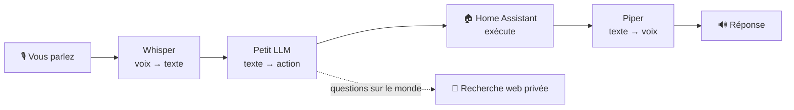

# 🗣️ TinyLLM — parlez à votre maison, 100 % en local

**Un assistant vocal pour Home Assistant qui écoute, réfléchit et répond entièrement sur un petit PC bon marché — sans cloud, sans GPU.**

🇬🇧 [English version](README.md) · 🚀 [Démarrage rapide](docs/fr/00-demarrage-rapide.md) · 📖 [L'étude complète](docs/fr/)

---

## En deux mots

- 🎙️ **Vous dites** « hey Jarvis, éteins les lumières du salon » — 🧠 **une petite IA comprend** — 💡 **la maison obéit** — 🔊 **une voix confirme**.
- Tout tourne sur **un seul mini-PC** (Intel i3, 4 threads, ~7 Go de RAM, **pas de carte graphique**). Votre voix et vos commandes **ne quittent jamais la maison**.
- Ce n'est **pas magique** : un petit modèle brut est mauvais à ce jeu (il réussit **18 %** de nos commandes de test). Un peu d'**affinage** l'amène à **93–96 %** — ce dépôt montre comment, et mesure tout.

## Comment ça marche



En coulisses, un petit **proxy** garde l'IA rapide et sûre (prompt réduit, contrôles de cohérence, « je ne sais pas » honnête). Tous les détails sont dans l'[architecture](docs/fr/02-architecture.md).

## Est-ce que ça marche ?

| | Ce que nous avons mesuré | Résultat |
|---|---|---|
| 🧠 **Comprendre les commandes** | part d'actions correctes sur 92 phrases de test en français | **93–96 %** (contre 18 % sans affinage) |
| 🎙️ **Vous entendre** | taux d'erreur de mots de Whisper | **6,5 %** (modèle `small`) |
| ⚡ **Des oreilles plus rapides** | un moteur vocal *en streaming* contre Whisper (parole synthétique) | **0,12 s** au lieu de 3 s après la fin de la parole, part de commandes correctes comparable |
| 🔊 **Parler** | temps pour préparer une réponse | **~0,2 s** |
| ⏱️ **Vitesse** | chaîne complète, à chaud | phrase simple **~3 s** · commande **~9–10 s** · question web **~20 s** |

> ⚠️ Limites honnêtes : une seule machine, le français uniquement, un banc de petite taille, et des modèles vocaux testés sur de la parole synthétique. Voir [leçons et limites](docs/fr/06-lecons-et-limites.md).

## Pourquoi du local ?

| 👍 Vous gagnez | 👎 Vous payez |
|---|---|
| **Confidentialité** : rien ne quitte la maison | **Vitesse** : des secondes, pas des millisecondes |
| **Indépendance** : fonctionne sans Internet | **Un assistant étroit** : très bon en domotique, faible en conversation générale |
| **Pas d'abonnement** : votre matériel, votre électricité | **Du travail** : données, entraînement, tests, un proxy à maintenir |
| **Maîtrise** : vous décidez comment il échoue (en sécurité) | **Réentraîner** quand vos appareils changent |

Plus de détails dans [avantages et inconvénients](docs/fr/05-avantages-et-inconvenients.md) (local contre cloud, et LoRA contre RAG contre prompt compact).

## Démarrer en 30 minutes

```bash
git clone https://github.com/kamahat/TinyLLM.git && cd TinyLLM/quickstart
docker compose up -d
```

Puis suivez le [**démarrage rapide**](docs/fr/00-demarrage-rapide.md) : connecter Home Assistant, essayer une commande, et apprendre à le rendre fiable.

## Explorer l'étude

| Page | Vous y trouverez |
|---|---|
| 🚀 [00 · Démarrage rapide](docs/fr/00-demarrage-rapide.md) | lancer toute la chaîne, connecter Home Assistant, dépanner |
| 🎯 [01 · Contexte et objectifs](docs/fr/01-contexte-et-objectifs.md) | la question, pourquoi c'est difficile sur un petit matériel |
| 🏗️ [02 · Architecture](docs/fr/02-architecture.md) | composants, schémas, le proxy compact et ses garde-fous |
| 🔬 [03 · Méthodes](docs/fr/03-methodes.md) | modèle brut, **LoRA**, **RAG**, prompt compact, recherche web |
| 📊 [04 · Résultats](docs/fr/04-resultats.md) | toutes les mesures : reconnaissance vocale, LLM, synthèse vocale, latence |
| ⚖️ [05 · Avantages et inconvénients](docs/fr/05-avantages-et-inconvenients.md) | local contre cloud, technique par technique |
| 🧯 [06 · Leçons et limites](docs/fr/06-lecons-et-limites.md) | incidents, pièges, ce qui n'a pas été mesuré |
| 🔁 [07 · Le reproduire](docs/fr/07-reproduire.md) | entraînement, validation, bascule en production |

Les tableaux de résultats en CSV sont dans [`results/`](results/). Les scripts sont dans [`scripts/`](scripts/) (commentaires surtout en français ; chemins et noms anonymisés).

## Licence

Apache-2.0 — voir [LICENSE](LICENSE).
