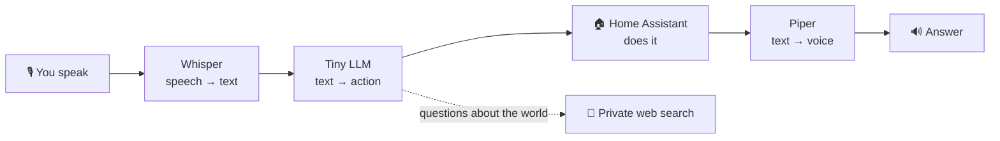

# 🗣️ TinyLLM — talk to your house, 100 % locally

**A voice assistant for Home Assistant that listens, thinks and answers entirely on a small, cheap PC — no cloud, no GPU.**

🇫🇷 [Version française](README.fr.md) · 🚀 [Quick start](docs/en/00-quick-start.md) · 📖 [The full study](docs/en/)

---

## In a nutshell

- 🎙️ **You say** "hey Jarvis, turn off the living-room lights" — 🧠 **a tiny AI understands** — 💡 **your home obeys** — 🔊 **a voice confirms**.
- Everything runs on **one mini-PC** (Intel i3, 4 threads, ~7 GB RAM, **no graphics card**). Your voice and your commands **never leave the house**.
- It is **not magic**: a small model out of the box is bad at this (it gets **18 %** of our test commands right). A little **fine-tuning** takes it to **93–96 %** — this repository shows how, and measures everything.

## How it works



Behind the scenes a small **proxy** keeps the AI fast and safe (smaller prompt, sanity checks, honest "I don't know"). All the details are in the [architecture](docs/en/02-architecture.md).

## Does it work?

| | What we measured | Result |
|---|---|---|
| 🧠 **Understanding commands** | share of correct actions on 92 French test phrases | **93–96 %** (vs 18 % without fine-tuning) |
| 🎙️ **Hearing you** | Whisper word error rate | **6.5 %** (`small` model) |
| 🔊 **Speaking** | time to prepare a reply | **~0.2 s** |
| ⏱️ **Speed** | whole chain, warm | simple phrase **~3 s** · command **~9–10 s** · web question **~20 s** |

> ⚠️ Honest limits: one machine, French only, a small benchmark, and speech models tested on synthetic speech. See [lessons and limits](docs/en/06-lessons-and-limits.md).

## Why go local?

| 👍 You gain | 👎 You pay |
|---|---|
| **Privacy**: nothing leaves your home | **Speed**: seconds, not milliseconds |
| **Independence**: works without Internet | **A narrow assistant**: great at home control, weak at general chat |
| **No fees**: your hardware, your electricity | **Some work**: data, training, tests, a proxy to maintain |
| **Control**: you decide how it fails (safely) | **Re-train** when your devices change |

More in [advantages and drawbacks](docs/en/05-pros-and-cons.md) (local vs cloud, and LoRA vs RAG vs compact prompt).

## Get started in 30 minutes

```bash
git clone https://github.com/kamahat/TinyLLM.git && cd TinyLLM/quickstart
docker compose up -d
```

Then follow the [**quick start**](docs/en/00-quick-start.md): connect Home Assistant, try a command, and learn how to make it reliable.

## Explore the study

| Page | You will find |
|---|---|
| 🚀 [00 · Quick start](docs/en/00-quick-start.md) | run the whole chain, connect Home Assistant, troubleshoot |
| 🎯 [01 · Context and goals](docs/en/01-context-and-goals.md) | the question, why it is hard on small hardware |
| 🏗️ [02 · Architecture](docs/en/02-architecture.md) | components, diagrams, the compact proxy and its guard-rails |
| 🔬 [03 · Methods](docs/en/03-methods.md) | stock model, **LoRA**, **RAG**, compact prompt, web search |
| 📊 [04 · Results](docs/en/04-results.md) | all measurements: speech-to-text, LLMs, text-to-speech, latency |
| ⚖️ [05 · Pros and cons](docs/en/05-pros-and-cons.md) | local vs cloud, technique by technique |
| 🧯 [06 · Lessons and limits](docs/en/06-lessons-and-limits.md) | incidents, pitfalls, what was not measured |
| 🔁 [07 · Reproduce](docs/en/07-reproduce.md) | training, validation, switching to production |

Result tables as CSV are in [`results/`](results/). Scripts are in [`scripts/`](scripts/) (comments mostly in French; paths and names anonymized).

## License

Apache-2.0 — see [LICENSE](LICENSE).
