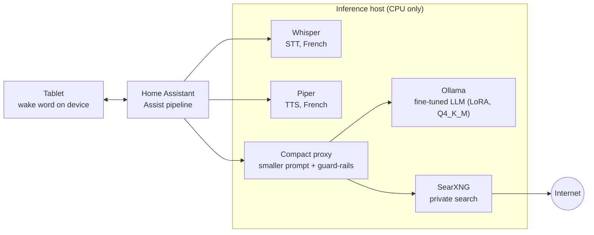
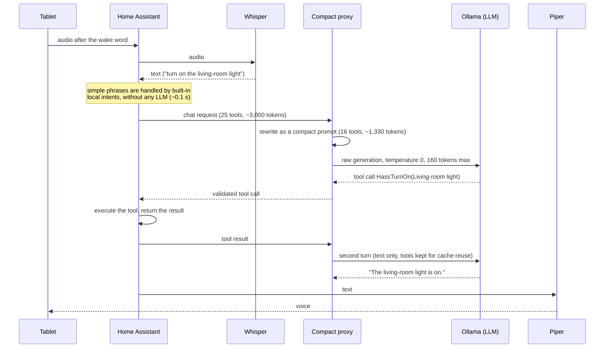
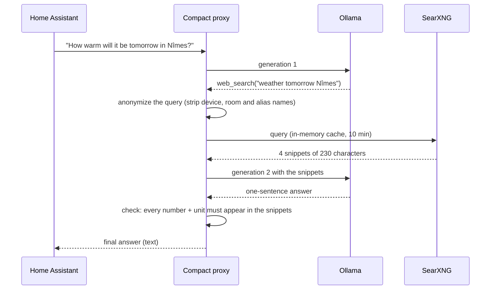
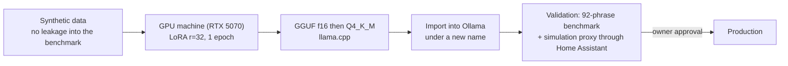

# 02 — Architecture

## Components

| Component | Where | Role |
|---|---|---|
| Android tablet | in the home | Home Assistant Companion app; **on-device** wake-word detection ("hey Jarvis"), microphone, speaker |
| Home Assistant | home server | *Assist* pipeline, conversation agent, executes tools (lights, shutters, scripts, lists…) |
| Whisper (faster-whisper, int8) | inference host | STT over the Wyoming protocol, French, `small-int8` with a short vocabulary prompt |
| Piper | inference host | TTS over Wyoming, voice `fr_FR-siwis-medium` |
| **Compact proxy** | inference host | Sits between Home Assistant and the LLM: shrinks the prompt, validates tool calls, runs the web search, applies guard-rails |
| Ollama | inference host | Serves the fine-tuned LLM on CPU (AVX2, 4 threads, flash attention) |
| SearXNG | inference host | Private meta-search engine, listening on localhost only |
| GPU machine | separate VM | **Training only** (one RTX 5070, 12 GB). It can stay powered off: production never depends on it |

The Whisper container image can also run other speech back-ends through the same Wyoming interface; two alternatives are compared in [04](04-results.md).

The inference host is a small x86 mini-PC (Intel Core i3-6100T, 4 vCPU, ~7 GB RAM for the VM, no GPU).

## Request flow: a smart-home command

## Request flow: a question about the outside world

The model has a `web_search` tool that the **proxy executes itself** (Home Assistant never sees it):

## The compact proxy

The native prompt of the smart-home framework is about **3,000 tokens**. On this CPU a cold prompt takes ~63 s, and any change in the prompt invalidates the cache. The proxy is a small Python service (`scripts/proxy/`) that makes the LLM's job short and predictable:

| Mechanism | Effect |
|---|---|
| Compact system prompt: one line per device (`name ~ alias \| domain \| area`) | prompt −56 % (≈1,330 tokens) |
| 16 compact tools (+ `web_search`) | fewer tokens, fewer wrong tool names |
| History reduced to text, 2 turns max | the LLM cache stays valid (a sliding history used to discard it: 25–37 s per request) |
| Tools kept in the prompt on turn 2, but any **new tool call is rejected** | no loops; removing the tools used to discard the cache |
| Tool names validated against the framework's list | an invented tool name is refused |
| Temperature 0, 160 tokens max, `keep_alive: -1` | the framework sends neither a temperature nor a length limit; without this the model samples at 0.6 and can generate thousands of tokens |
| `--sim` mode | strips every tool call from the answer: used for testing without executing anything |

### Deterministic guard-rails

Small LLMs fail in repeatable ways. Instead of hoping the next fine-tune fixes them, the proxy corrects them with plain code:

| Guard-rail | Failure covered | Replacement |
|---|---|---|
| `guard_unavailable` | a value question on a sensor that is `unavailable`: the model invented "0 degrees" | "I have no recent value for …: the sensor is unavailable." |
| `guard_success` | the tool succeeded but the model says "device not found" | "Done." |
| `grounded` (web) | a number the snippets do not contain: invention, or a postal code read as a distance | "I could not find a reliable answer." |
| Turn-2 rejection | a new tool call after a tool result | text-only answer |

## Training chain (not part of production)

The training format is **exactly** the proxy's format (one shared Python module), so the model is trained on the same compact system prompts, tools and tool results it sees in production.
