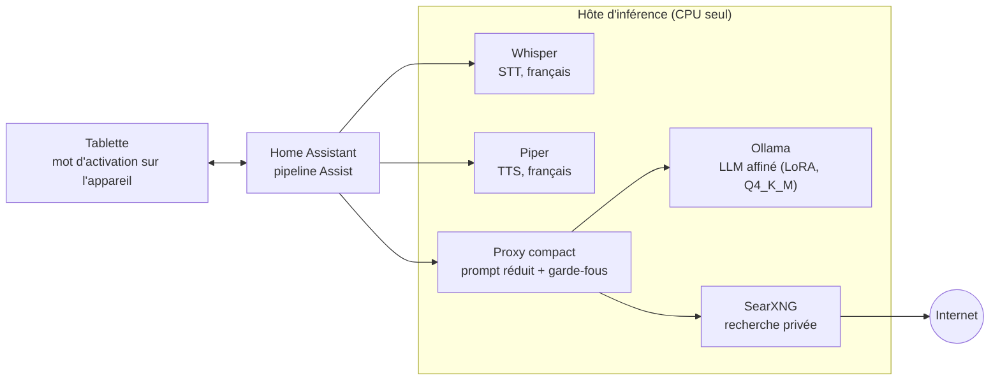
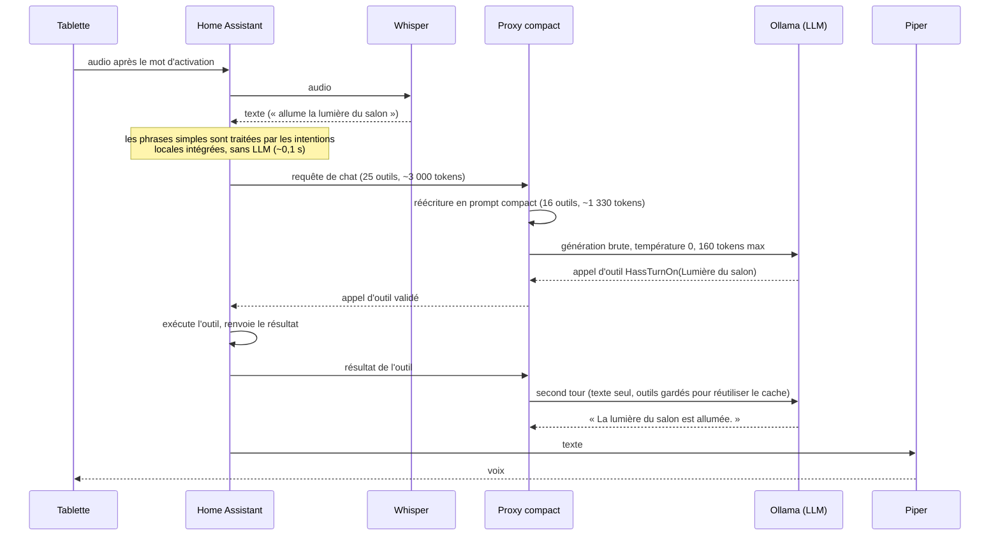
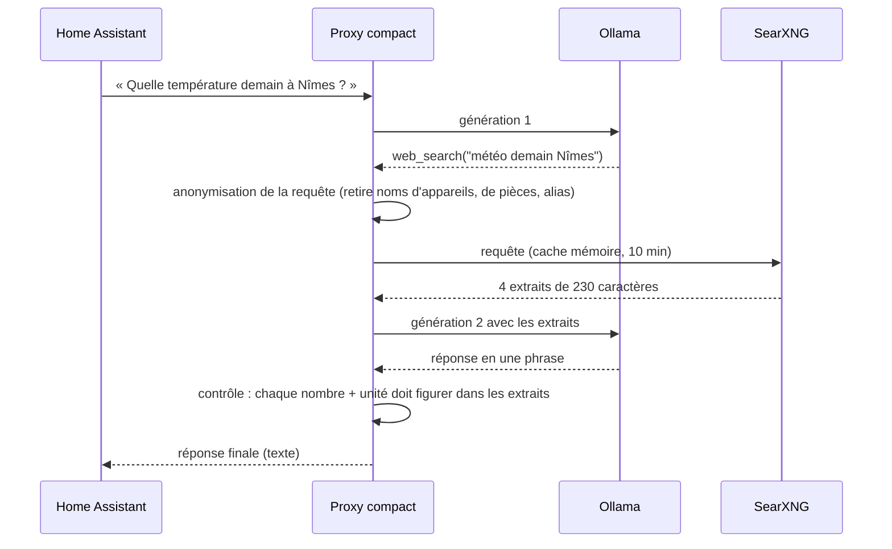
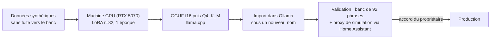

# 02 — Architecture

## Composants

| Composant | Où | Rôle |
|---|---|---|
| Tablette Android | dans la maison | Application Companion de Home Assistant ; détection du mot d'activation (« hey Jarvis ») **sur l'appareil**, micro, haut-parleur |
| Home Assistant | serveur domotique | Pipeline *Assist*, agent de conversation, exécute les outils (lumières, volets, scripts, listes…) |
| Whisper (faster-whisper, int8) | hôte d'inférence | STT via le protocole Wyoming, français, `small-int8` avec un court prompt de vocabulaire |
| Piper | hôte d'inférence | TTS via Wyoming, voix `fr_FR-siwis-medium` |
| **Proxy compact** | hôte d'inférence | Entre Home Assistant et le LLM : réduit le prompt, valide les appels d'outils, exécute la recherche web, applique les garde-fous |
| Ollama | hôte d'inférence | Sert le LLM affiné sur CPU (AVX2, 4 threads, flash attention) |
| SearXNG | hôte d'inférence | Méta-moteur de recherche privé, à l'écoute sur localhost uniquement |
| Machine GPU | VM séparée | **Entraînement uniquement** (une RTX 5070, 12 Go). Elle peut rester éteinte : la production n'en dépend jamais |

L'image du conteneur Whisper sait aussi lancer d'autres moteurs vocaux via la même interface Wyoming ; deux alternatives sont comparées en [04](04-resultats.md).

L'hôte d'inférence est un petit mini-PC x86 (Intel Core i3-6100T, 4 vCPU, ~7 Go de RAM pour la VM, sans GPU).

## Flux d'une requête : une commande domotique

## Flux d'une requête : une question sur le monde extérieur

Le modèle dispose d'un outil `web_search` que le **proxy exécute lui-même** (Home Assistant ne le voit jamais) :

## Le proxy compact

Le prompt natif du framework domotique fait environ **3 000 tokens**. Sur ce CPU, un prompt à froid prend ~63 s, et tout changement du prompt invalide le cache. Le proxy est un petit service Python (`scripts/proxy/`) qui rend le travail du LLM court et prévisible :

| Mécanisme | Effet |
|---|---|
| Système compact : une ligne par appareil (`nom ~ alias \| domaine \| zone`) | prompt −56 % (≈1 330 tokens) |
| 16 outils compacts (+ `web_search`) | moins de tokens, moins de noms d'outils erronés |
| Historique réduit au texte, 2 tours maximum | le cache du LLM reste valide (un historique glissant le jetait : 25 à 37 s par requête) |
| Outils gardés dans le prompt au tour 2, mais tout **nouvel appel d'outil rejeté** | pas de boucle ; retirer les outils jetait le cache |
| Noms d'outils validés contre la liste du framework | un nom inventé est refusé |
| Température 0, 160 tokens max, `keep_alive: -1` | le framework n'envoie ni température ni limite de longueur ; sans cela le modèle échantillonne à 0,6 et peut générer des milliers de tokens |
| Mode `--sim` | retire tous les appels d'outils de la réponse : sert aux tests sans rien exécuter |

### Garde-fous déterministes

Les petits LLM échouent de façon reproductible. Plutôt que d'espérer que le prochain affinage les corrige, le proxy les corrige avec du code simple :

| Garde-fou | Défaut couvert | Remplacement |
|---|---|---|
| `guard_unavailable` | question de valeur sur un capteur `unavailable` : le modèle inventait « 0 degré » | « Je n'ai pas de valeur récente pour … : le capteur est indisponible. » |
| `guard_success` | l'outil a réussi mais le modèle dit « appareil introuvable » | « C'est fait. » |
| `grounded` (web) | un nombre absent des extraits : invention, ou code postal lu comme une distance | « Je n'ai pas trouvé de réponse fiable. » |
| Rejet au tour 2 | nouvel appel d'outil après un résultat d'outil | réponse en texte seul |

## Chaîne d'entraînement (hors production)

Le format d'entraînement est **exactement** celui du proxy (un module Python partagé) : le modèle est entraîné sur les mêmes systèmes compacts, outils et résultats d'outils que ceux qu'il voit en production.
